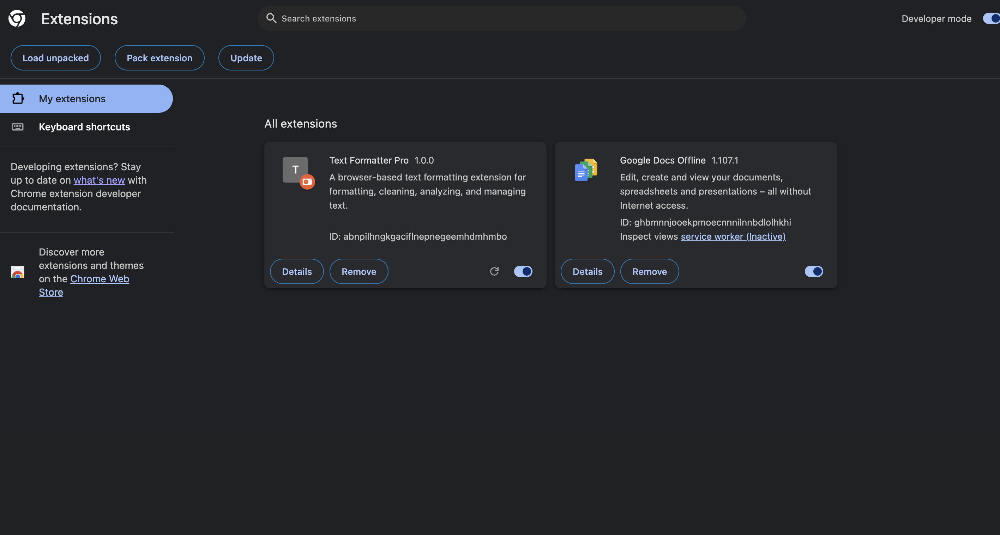

# Text Formatter Pro Installation Guide

## Table of Contents

- [Overview](#overview)
- [Prerequisites](#prerequisites)
- [Installation](#installation)
- [Verification](#verification)

## Overview

Text Formatter Pro is a React-based Chrome Extension which gives formatting and cleanup utilities directly. 
 
## Prerequisites

Before installing,mmake sure following are available on your machine:

- Git
- Google Chrome or a Chromium-based browser
- Node.js
- npm package manager

## Installation

The Extension can be installed with the following steps. 

### Install from VSIX Package

1. Clone the project repository:
```bash
git clone <repository-url>
```

2.Navigate to the project directory:
```bash
cd text-formatter-pro
```

Install the project dependencies:
```bash
npm install
```

Create the production build:
```bash
npm run build
```

The production-ready `dist` folder is generated.
3. Open Google Chrome and navigate to:
 ```bash
chrome://extensions/
```
4.Enable Developer Mode.

5.Click Load unpacked.

6.Select the generated `dist` folder.

7. Confirm that **Text Formatter Pro** appears in the Chrome Extensions list.

8. The extension is now installed and ready to use.

## Verification

1.Open **Text Formatter Pro** from toolbar.

2.Verify it popup when clicked. 

3.Check if text editor is displayed. 

4.Verify if functionality is working correctly. 

5.Check if all options are accessible. 

6.Verify statistics are updated correctly. 



