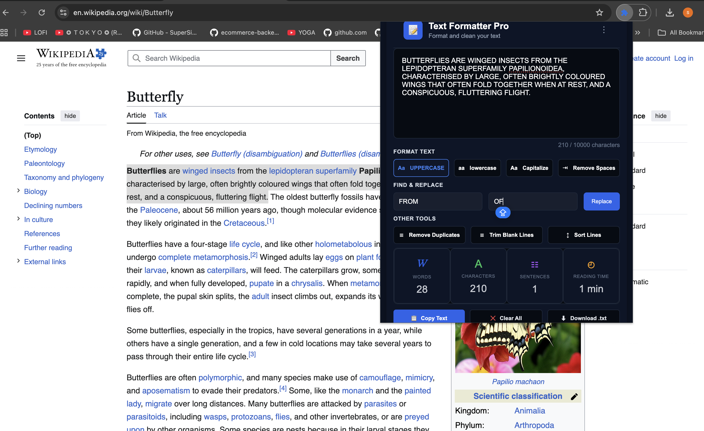
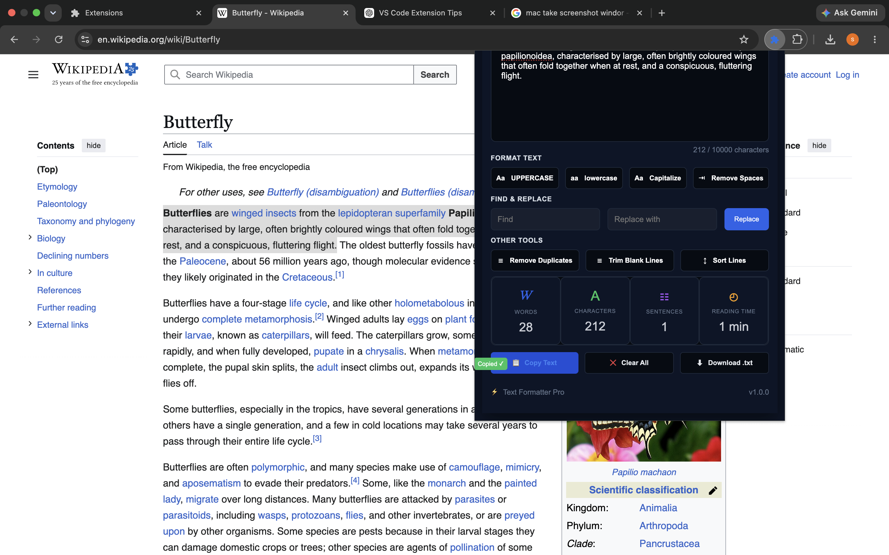

# Text Formatter Pro



### Demo in Chrome



## Table of Contents

- [Overview](#overview)
- [Features](#features)
- [Technology Stack](#technology-stack)
- [Project Structure](#project-structure)
- [Prerequisites](#prerequisites)
- [Installation](#installation)
- [Usage](#usage)
- [Limitations](#limitations)

## Overview

Text Formatter Pro is a React based 
Chrome Extension which allows to format, cleanup, perform analysis to text inside the browser. 

It has features - case conversion, cleanup functions,find and replace, 
history management and statistics tracking. 

The goal is to deliver fast, easy to use 
text formatter in the browser. 

## Features

Text Formatter Pro provides the following features:

- Convert text to uppercase
- Convert text to lowercase
- Capitalize words
- Remove extra spaces
- Remove duplicate lines
- Trim blank lines
- Sort lines alphabetically
- Find and replace text
- Paste text from clipboard
- Copy formatted text
- Download text as a `.txt` file
- Clear editor content
- View text statistics such as word count, character count, line count, and reading time
- Manage recent text history
- Restore previously used text
- Delete individual history items
- Clear all history
- Enable or disable auto-save
- Automatically restore saved text
- Customize character limit
- Customize Recent Texts settings

## Technology Stack

| Technology | Purpose |
|---|---|
| React | Component-based user interface |
| JavaScript | Application logic and text processing |
| CSS3 | Responsive extension styling |
| Chrome Extension APIs | Browser integration |
| Chrome Storage API | Local data persistence |
| Manifest V3 | Extension configuration |
| Vite | Development and build tooling |

## Project Structure

```text
text-formatter-pro/

├── public/
│   ├── icons/
│   └── manifest.json
│
├── src/
│   ├── components/
│   ├── context/
│   ├── hooks/
│   ├── utils/
│   ├── App.jsx
│   ├── App.css
│   ├── main.jsx
│   └── index.css
│
├── docs/
│   ├── screenshots/
│   └── documentation files
│
├── package.json
├── vite.config.js
├── README.md
└── LICENSE
```

## Prerequisites

To use Text Formatter Pro,you must have following:

- Google Chrome or a Chromium-based browser
- Node.js installed
- npm package manager
- Git version control

## Installation

To install the extension follow below steps. 

1.Clone the repository. 

```
git clone repo-name
```
2.Navigate to folder

```
cd project-name
```
3.Install the required dependencies. 

```
npm install 
```
4.Build the extension:

```bash
npm run build
```
5.Open Google Chrome

6.Navigate to:

```bash
chrome://extensions/
```
7.Enable Developer Mode

8.Click Load unpacked

9.Select the generated dist folder

## Usage

1.Open the extension from browser Toolbar.
2.Type the text or paste on textarea if extension.
3.Select a formatting option.
4.Review the text statistics.
5.Copy or download the formatted text.
6.Use undo option,put character limit, read about me. 

Additional tools are available from the menu, including **Recent Texts** and **Auto Save**.

## Limitations

- Currently supports Chromium-based browsers only.
- Requires browser permissions for storage and clipboard features.
- Works only as a browser extension (no standalone desktop/mobile version).
- No cloud synchronization.


