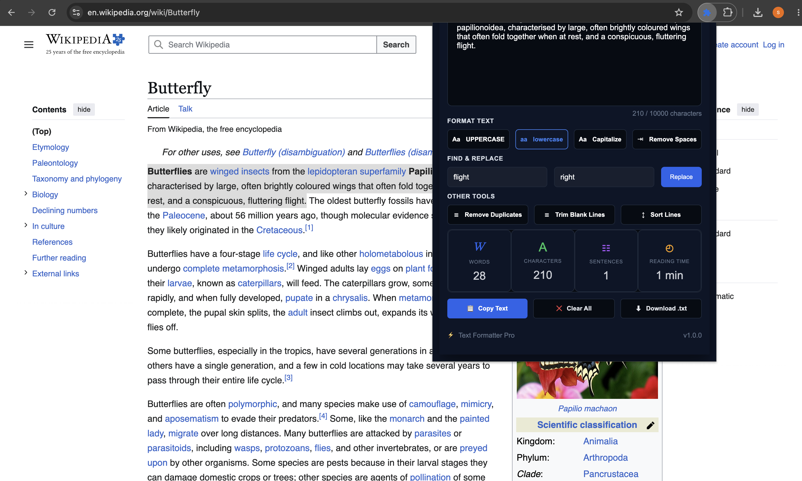
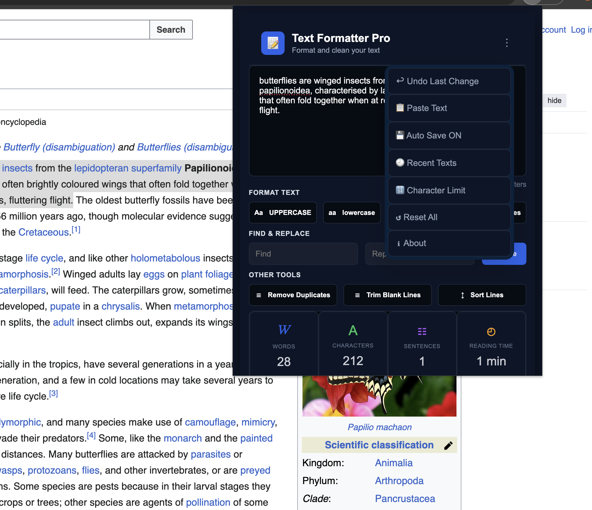
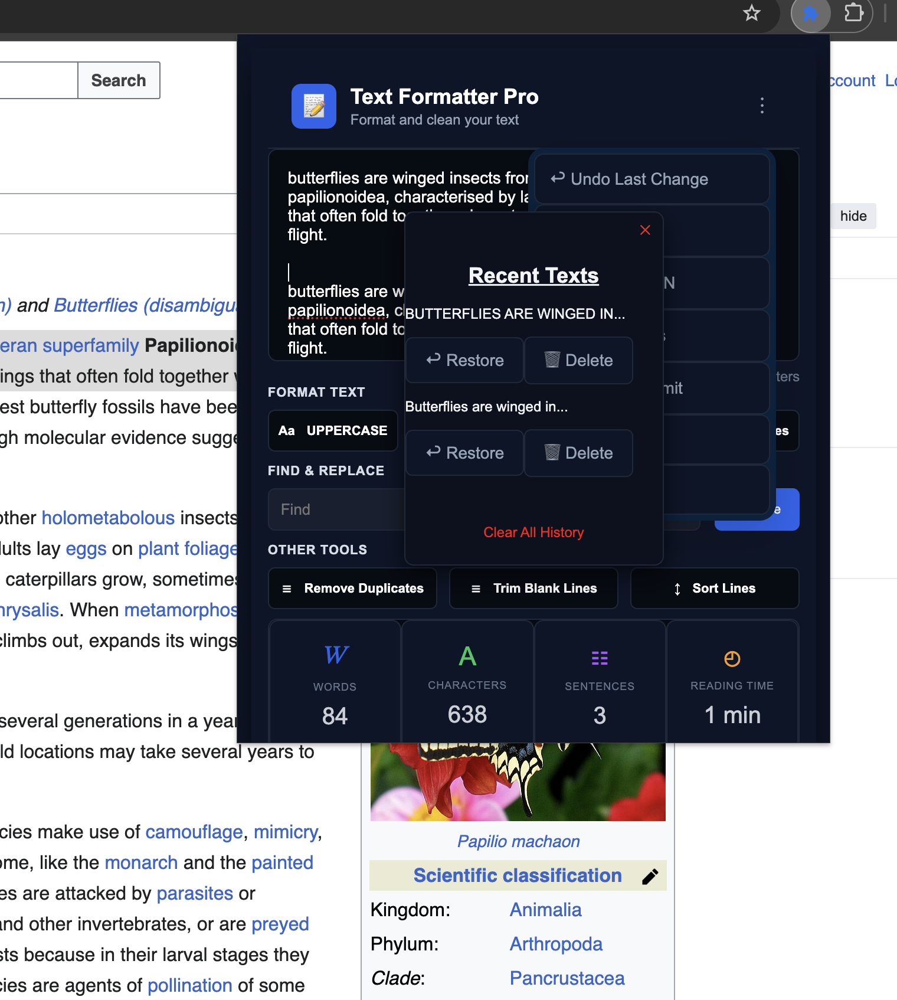
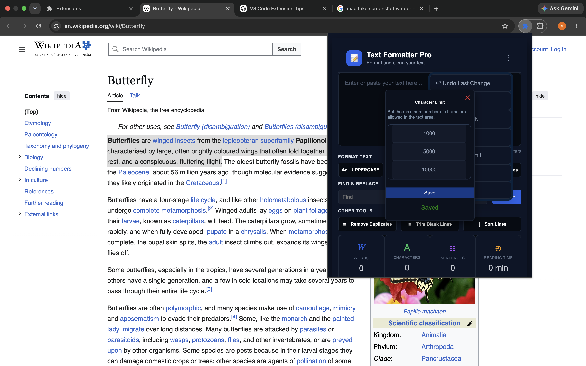
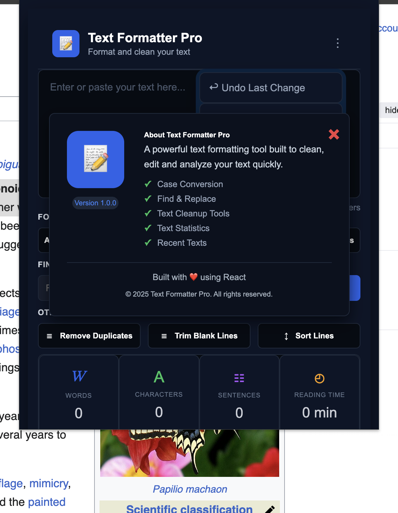

# Text Formatter Pro User Guide

## Table of Contents

- [Overview](#overview)
- [Getting Started](#getting-started)
- [How to Use](#how-to-use)
- [Features](#features)
- [Common Tasks](#common-tasks)

## Overview

Text Formatter Pro is a React-based Chrome extension which is used to simplify text editing workflows such as formatting, doing cleanup and provid text management tools. 

The extension provides many features - case conversion, cleanup operations, find and replace, statistics tracking and history management with local Storage. 

## Getting Started

Text Formatter Pro requires:

- Google Chrome or Chromium-based browser
- Local browser storage access. 

It does not require a user account and performs text operations locally inside the browser.

### Main Interface

## How to Use

1. Open the extension from toolbar. 

2. Type or paste the text to edit.

3. Select a formatting or cleanup option.

4. Review the updated text and statistics.

5. Use **Copy** to copy the formatted text.

6. Use **Download** to save the text as a `.txt` file.

## Features
### Three Dots Menu

- Convert text to uppercase
- Convert text to lowercase
- Capitalize words
- Remove extra spaces
- Remove duplicate lines
- Trim blank lines
- Sort lines alphabetically
- Find and replace text
- Copy formatted text
- Paste text from clipboard
- Download text as a `.txt` file
- View real-time text statistics
- Manage recent text history
- Enable or disable Auto Save
- Customize character limits
- Reset application preferences

## Common Tasks

### Clean Text

Use the cleanup tools to:

- Remove extra spaces
- Remove duplicate lines
- Trim blank lines
- Sort lines alphabetically

### Find and Replace Text

1. Enter the text to find.
2. Enter the replacement text.
3. Select **Replace**.

### Copy or Download Text

- Select **Copy** to copy the current text.
- Select **Download** to export the text as a `.txt` file.

### Manage Recent Texts

Open **Recent Texts** to:

- Restore saved text
- Delete individual history items
- Clear complete history

### Use Auto Save

Open the menu and enable **Auto Save** to automatically save and restore the current text.

### Change Character Limit

Open **Character Limit** from the menu to customize the maximum text length allowed in the editor.

### Reset Preferences

Open **Reset Preferences** and select **Reset All** to restore the default application settings.

### About Section

